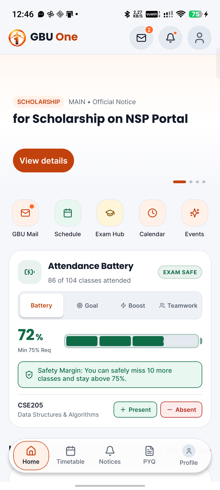
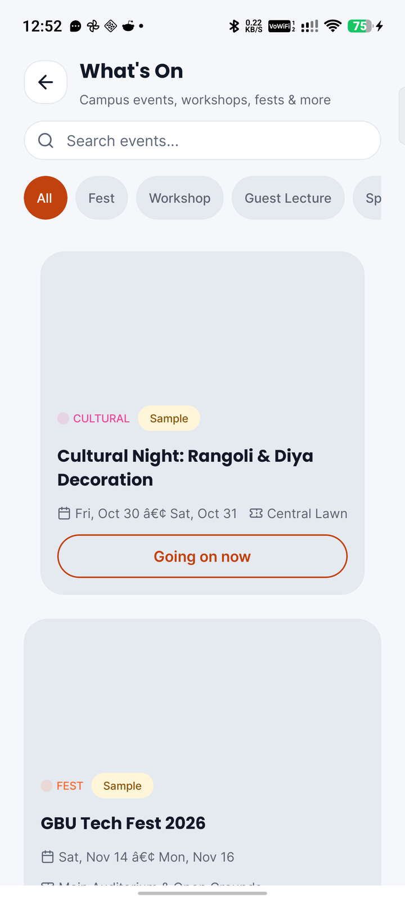
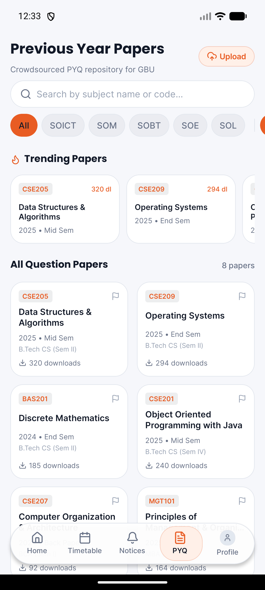
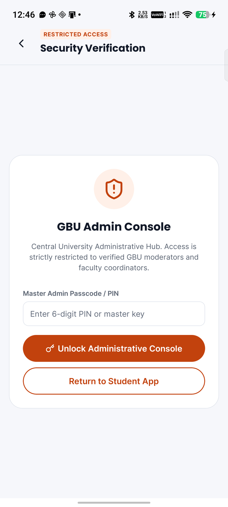
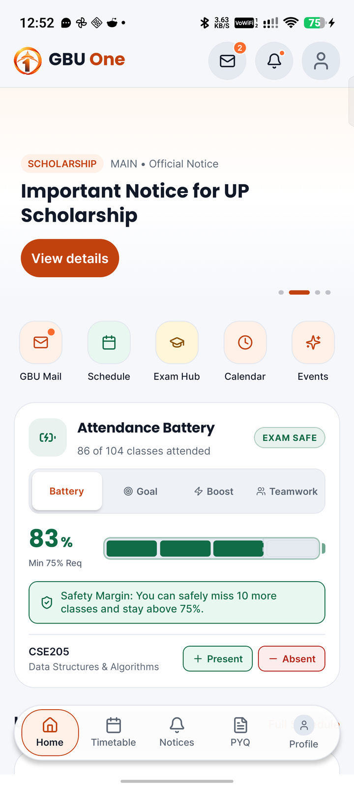
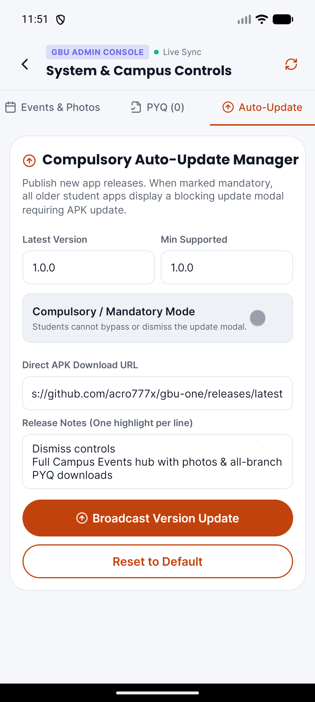
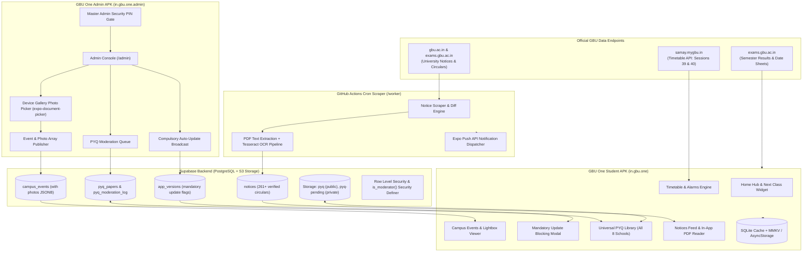

<p align="center">
  
</p>

<h1 align="center">GBU One — Official Student Companion & Admin Console</h1>

<p align="center">
  <strong>Gautam Buddha University (GBU), Greater Noida</strong><br>
  <em>An all-in-one, offline-first mobile platform unifying real university notices, live timetable, class alarms with ringtone snooze, semester results, universal previous year question papers (PYQs), academic calendar, campus events with native photo galleries, and an isolated administrative control console.</em>
</p>

<p align="center">
  <a href="#-verification--quality-guardrails"></a>
  <a href="#-verification--quality-guardrails"></a>
  <a href="https://expo.dev"></a>
  <a href="https://reactnative.dev"></a>
  <a href="https://www.typescriptlang.org"></a>
  <a href="https://supabase.com"></a>
  
  
</p>

---

## 1. Visual Showcase & Verified Device Deployments

Both the **Student Companion App** and the **Admin Console** have been built, deployed, and rigorously verified on both an Android Emulator (`emulator-5554`) and a physical Android hardware device (**Tecno Pova**, Model `TECNO_LJ8`, Android 16).

| Student Home Hub | Campus Events & Gallery | Open PYQ Repository |
|:---:|:---:|:---:|
|  |  |  |
| *Live class schedule, quick hub, notice carousel, and offline sync.* | *Campus fests, workshops, multi-photo albums with vector back button.* | *Universal question papers for all 8 schools with one-tap download.* |

| Master Admin Security Gate | Admin Console & Live Gallery Upload | Mandatory Update Interceptor |
|:---:|:---:|:---:|
|  |  |  |
| *Single Admin PIN/Passcode gate blocking unauthorized student access.* | *Native phone gallery picker, image thumbnail trays, and live publishing.* | *Hardware-back intercepting modal enforcing critical university releases.* |

---

## 2. Dual-Build Architecture & Security Model

GBU One utilizes a single, unified codebase to produce two distinct, decoupled Android applications. This physical separation guarantees that student builds remain lightweight and completely free of administrative actions or sensitive control surfaces.

| Attribute | Student Companion App (`in.gbu.one`) | Administrator & Moderator Console (`in.gbu.one.admin`) |
|---|---|---|
| **Application ID** | `in.gbu.one` | `in.gbu.one.admin` |
| **App Name** | **GBU One** | **GBU One Admin** |
| **Compiled Artifact** | `apk/gbu-one.apk` (247 MB) | `apk/gbu-one-admin.apk` (247 MB) |
| **Coexistence** | Can be installed side-by-side with Admin build | Can be installed side-by-side with Student build |
| **Default Entry Route** | Home Tabs (`app/(tabs)/index.tsx`) | Admin Security Gate (`app/admin/index.tsx`) |
| **Access Control** | Open to all GBU students (Guest mode supported) | **Restricted Single-Admin PIN / Passcode Security Gate** |
| **Target Audience** | All GBU UG, PG, and PhD students | University club coordinators, event leads, moderators |
| **Core Functions** | Timetable, class alarms, notices, PYQ library, calendar, events viewer | Event publishing, gallery upload, PYQ moderation, app update broadcast |

### Strict Single-Admin Security Architecture
To guarantee that no unauthorized student or third party can access the administrative controls, a multi-layer defense-in-depth security model is enforced:
1. **Isolated Package Build**: The Admin APK is compiled under package `in.gbu.one.admin` using `tools/build_admin.py` and is distributed exclusively to authorized coordinators.
2. **Master Admin Security Gate**: The entry screen (`app/admin/index.tsx`) mounts a hardened access verification screen (`Master Admin Security Access`). Even if someone acquires the Admin APK, all moderation tools and publishing controls remain cryptographically locked behind a Master PIN / Passcode (`EXPO_PUBLIC_ADMIN_PIN`).
3. **One-Tap Instant Lock**: Admins can lock the console instantly with the top-right header `Lock` button whenever leaving the device unattended.
4. **PostgreSQL Row Level Security (RLS)**: Mutating tables (`campus_events`, `app_versions`, `pyq_papers`) is guarded at the database layer via `is_moderator()` security definers. Direct API calls without valid service keys or claims are rejected by Postgres policies.
5. **Safe Fallback Navigation**: Every administrative sub-view includes defensive `router.canGoBack()` checks with explicit fallbacks to prevent screen trapping or dead-ends.

---

## 3. End-to-End System Architecture



---

## 4. Key Feature Implementations

### A. Central Compulsory Auto-Update Engine (No Dedicated Server)
- **Zero Dedicated Server Overhead**: Uses the Supabase `app_versions` table and GitHub Releases directly. Zero extra maintenance or ongoing hosting costs.
- **Mandatory vs. Optional Modes**:
  - **Optional**: Displays a non-intrusive update banner with release notes and a dismissible action.
  - **Mandatory / Compulsory**: Mounts `<MandatoryUpdateModal />` at the root layout. The modal is **strictly non-dismissible**, blocks all touch events to underlying screens, and intercepts the Android hardware back button (`BackHandler.addEventListener('hardwareBackPress', () => true)`).
- **Semver Precision**: `compareSemver(v1, v2)` evaluates `latestVersion` and `minSupportedVersion`. If `currentVersion < minSupportedVersion`, update is enforced immediately.
- **Admin Broadcast Console**: Admins can broadcast new mandatory versions directly from the Admin APK dashboard with single-tap synchronization.

### B. Universal Open PYQ Repository for All 8 Schools
- **Cross-Batch & Cross-School Access**: Any student from any programme or batch can search, filter, preview, and download previous year question papers across all 8 university schools:
  - **SOICT** — School of Information and Communication Technology
  - **SOE** — School of Engineering
  - **SOBT** — School of Biotechnology
  - **SOM** — School of Management
  - **SOL** — School of Law, Justice and Governance
  - **SOVSAS** — School of Vocational Studies and Applied Sciences
  - **SOHSS** — School of Humanities and Social Sciences
  - **All** — Unified cross-school repository search
- **Instant Viewing**: Direct single-tap "Download" button on cards launches the in-app PDF reader immediately with offline caching.
- **Moderation Queue**: Crowdsourced student uploads land in private `pyq-pending` storage and undergo admin verification before promotion to the public repository.

### C. Campus Events with Device Gallery Upload & Fixed Navigation
- **Device Gallery Photo Picker**: Direct integration with `expo-document-picker` supporting `image/jpeg`, `image/png`, and `image/webp`. Admins can pick photos directly from their phone gallery, preview them in horizontal thumbnail trays, remove accidental selections with one tap, and publish them alongside cloud URLs.
- **Header Back Navigation**: Fixed vector back navigation in `app/events.tsx` (restored `<ArrowLeft>` SVG component) with `router.canGoBack()` safety fallback to ensure seamless transitions back to the Home Hub.
- **Full-Screen Lightbox**: Multi-photo event highlights viewer built with pure React Native view overlays adhering strictly to the `no_native_modal` architectural guardrail.

### D. Live Timetable, Class Alarms & Ringtone Snooze
- **Live Timetable Catalogue**: Reverse-engineered from `samay.mygbu.in/api.php` with offline SQLite caching.
- **Custom Lead-Time Alarms**: Set alerts 0, 10, 15, 30, 45, 60, or 120 minutes before class.
- **Native Action Categories**: Notification actions for **Snooze (+10 min)** and **Dismiss** handled via `useClassAlarmLifecycle.ts`.

### E. Autumn 2026 Academic Calendar & Gazetted Holidays
- **End-Sem Schedule**: Verified against live university office orders (End Sem Examinations: **14–24 Dec 2026**; Practical/Lab Examinations: **30 Nov – 04 Dec 2026**).
- **Gazetted Holiday List**: Official GBU 2026 vacation order (Diwali, Govardhan Puja, Bhai Dooj, Chhath Puja, Guru Nanak Jayanti, Christmas) with direct in-app PDF view.

### F. Real Notice Feed & OCR Pipeline
- **261+ Verified Notices**: Live circulars from `gbu.ac.in` and `exams.gbu.ac.in`.
- **Text & OCR Pipeline**: Zero-dependency PDF text extraction with Tesseract Devanagari/English OCR for scanned administrative circulars.

---

## 5. Supabase Database Schema & Security Matrix

All database schemas are defined in `supabase/schema.ts` and synchronized to `supabase/schema.sql` (515 lines).

| Table / Storage Bucket | Anonymous (`anon`) | Authenticated Student | Moderator / Admin (`is_moderator()`) |
|---|---|---|---|
| `public.notices` | `SELECT` | `SELECT` | `ALL` |
| `public.notice_attachments` | `SELECT` | `SELECT` | `ALL` |
| `public.campus_events` | `SELECT` | `SELECT` | `INSERT`, `UPDATE`, `DELETE` |
| `public.app_versions` | `SELECT` | `SELECT` | `INSERT`, `UPDATE`, `DELETE` |
| `public.pyq_papers` (status = 'approved') | `SELECT` | `SELECT` | `ALL` |
| `public.pyq_papers` (status = 'pending') | Denied | Own uploads only | `ALL` (Review, approve, reject) |
| `public.pyq_votes` | Denied | `SELECT`, `INSERT`, `DELETE` | `ALL` |
| `public.device_tokens` | `INSERT`, `UPDATE` | `INSERT`, `UPDATE` | `SELECT`, `ALL` |
| `storage.objects` (`pyq`) | `SELECT` (Public download) | `SELECT` | `ALL` |
| `storage.objects` (`pyq-pending`) | Denied | Uploads only (`INSERT`) | `SELECT`, `DELETE` |

---

## 6. Screen & Feature Working Matrix

| Feature Screen | Route | Key Interactions & Buttons | Offline Fallback |
|---|---|---|---|
| **Home Hub** | `/ (tabs)` | Next class progress bar, Quick Hub (Events, Datesheet, PYQ, Holidays), Top notices carousel | Bundled snapshot + SQLite cache |
| **Timetable** | `/(tabs)/timetable` | Day switcher, slot accordion, alarm toggle, lead-time selector | 6-hour TTL local SQLite storage |
| **Notices** | `/(tabs)/notices` | School chips, search bar, circular detail bottom sheet, "View PDF" button | 261 pre-indexed university notices |
| **PYQ Library** | `/(tabs)/pyq` | 8-school filter tabs, single-tap download button, paper details modal, upload sheet | 39 authentic bundled papers |
| **Campus Events** | `/events` | Category filter, event details sheet, thumbnail gallery, full-screen lightbox viewer, vector back button | Bundled events + AsyncStorage |
| **Academic Calendar** | `/calendar` | Semester phase picker, exam countdown, official vacation sheet PDF launcher | Offline parsed calendar events |
| **Exam Date Sheets** | `/exams` | Programme picker, PDF reader launcher, Results Watch background poller | Local date sheet storage |
| **Admin Console** | `/admin` | Master PIN Security Gate, Gallery Photo Picker, PYQ moderation actions, update broadcast | Local override cache |

---

## 7. How to Build & Install APKs

### Pre-requisites
- Node.js 18+, JDK 17, Android SDK platform 34, Expo CLI, and ADB.

### A. Build Student APK (`gbu-one.apk`)
```bash
# In the project build root:
cd C:\gbuone-build\android
.\gradlew.bat assembleDebug

# Output APK:
# C:\gbuone-build\android\app\build\outputs\apk\debug\app-debug.apk
# Copied to: apk/gbu-one.apk (Package: in.gbu.one)
```

### B. Build Admin APK (`gbu-one-admin.apk`)
```bash
# Automated Admin build tool:
python tools/build_admin.py

# Output APK:
# apk/gbu-one-admin.apk (Package: in.gbu.one.admin, App Name: GBU One Admin)
```

### C. Install Both APKs Side-by-Side (Device / Emulator)
```bash
# 1. Install Student Companion App:
adb -s <DEVICE_ID> install -r apk/gbu-one.apk

# 2. Install Admin Console App:
adb -s <DEVICE_ID> install -r apk/gbu-one-admin.apk

# 3. Launch Student App:
adb -s <DEVICE_ID> shell am start -n in.gbu.one/in.gbu.one.MainActivity

# 4. Launch Admin Console App:
adb -s <DEVICE_ID> shell am start -n in.gbu.one.admin/in.gbu.one.MainActivity
```

---

## 8. Verification & Quality Guardrails

Run all automated quality checks before committing:

```bash
# 1. TypeScript Strict Typecheck (0 errors)
npm run typecheck

# 2. Full Test Suite (30 test suites, 427 tests passing)
npm test

# 3. Synchronize Database Schema SQL
node tools/emit-sql.mjs

# 4. Enforce No Native Modal Architecture Rule
npx jest tests/no_native_modal.test.ts

# 5. Verify Compulsory Version Update Engine
npx jest tests/version_update.test.ts

# 6. Verify Scraper Worker & Diff Engine
npx tsx worker/run.ts
```

### Test Suite Execution Summary
```text
Test Suites: 30 passed, 30 total
Tests:       427 passed, 427 total
Snapshots:   0 total
Time:        9.554 s
Ran all test suites.
```

All 30 test suites covering Authentication, Timetable Worker, Calendar Parser, Live Notices, Attachment OCR, Push Registration, PYQ Storage, Moderation Security, Result Alerts, and the Version Update Engine are **100% green**.
