# GBU One — Official Student Companion & Admin Console

> **Gautam Buddha University (GBU), Greater Noida**  
> An all-in-one, offline-first mobile platform unifying real university notices, timetable, class alarms, exam results, previous year question papers (PYQs), academic calendar, campus events with photo galleries, and a dedicated administrator control console.

[](#-verification--quality-guardrails)
[](#-verification--quality-guardrails)
[](https://expo.dev)
[](https://reactnative.dev)
[](https://www.typescriptlang.org)
[](https://supabase.com)
[](#)

---

## 1. System Overview & Dual-Build Ecosystem

GBU One is engineered as a unified codebase that builds two synchronized Android applications:

| Attribute | Student Companion App | Administrator & Moderator Console |
|---|---|---|
| **Android Application ID** | `in.gbu.one` | `in.gbu.one.admin` |
| **App Name** | **GBU One** | **GBU One Admin** |
| **Compiled APK** | `apk/gbu-one.apk` (248 MB) | `apk/gbu-one-admin.apk` (247 MB) |
| **Side-by-Side Install** | Yes (coexists on same phone) | Yes (coexists on same phone) |
| **Default Entry Route** | Home Tabs (`app/(tabs)/index.tsx`) | Admin Console (`app/admin/index.tsx`) |
| **Target Audience** | All GBU undergraduate & postgraduate students | Club presidents, faculty leads & admins |
| **Primary Capabilities** | Timetable, class alarms, notices, open PYQ repository, academic calendar, events gallery | Live event & photo publishing, PYQ moderation queue, compulsory app update broadcast |

---

## 2. Architecture & Data Flow

```mermaid
flowchart TD
    subgraph External["Official GBU Data Endpoints"]
        GBU_Notices["gbu.ac.in & exams.gbu.ac.in\n(Notices & Circulars)"]
        Samay_API["samay.mygbu.in\n(Timetable API: schd=39 & 40)"]
        Exam_Portals["exams.gbu.ac.in\n(Results & Date Sheet PDFs)"]
    end

    subgraph Worker["GitHub Actions Cron Scraper (/worker)"]
        NoticeScraper["Notice Scraper & Diff Engine"]
        AttachmentOCR["PDF Text Layer + Tesseract OCR Pipeline"]
        PushSender["Expo Push API Dispatcher"]
    end

    subgraph Cloud["Supabase Backend (PostgreSQL + S3 Storage)"]
        DB_Notices[("notices (245+ verified)")]
        DB_PYQ[("pyq_papers & pyq_moderation_log")]
        DB_Events[("campus_events (with photos JSONB)")]
        DB_Versions[("app_versions (mandatory update flags)")]
        Storage_Buckets[("Storage: pyq (public), pyq-pending (private)")]
        RLS_Policy["Row Level Security & is_moderator() Security Definer"]
    end

    subgraph AdminTarget["GBU One Admin APK (in.gbu.one.admin)"]
        AdminDashboard["Admin Console (/admin)"]
        EventPublisher["Event & Photo Publisher"]
        ModQueue["PYQ Moderation Queue"]
        UpdateManager["Compulsory Auto-Update Manager"]
    end

    subgraph StudentTarget["GBU One Student APK (in.gbu.one)"]
        HomeView["Home & Quick Hub"]
        TimetableEngine["Timetable & Alarms Engine"]
        NoticeFeed["Notices Feed & PDF Reader"]
        PYQRepo["Open PYQ Library (All 8 Schools)"]
        EventsGallery["Campus Events & Photo Viewer"]
        UpdateGuard["Mandatory Update Blocking Modal"]
        LocalCache[("SQLite Cache + MMKV / AsyncStorage")]
    end

    GBU_Notices --> NoticeScraper
    NoticeScraper --> AttachmentOCR --> DB_Notices
    Worker --> PushSender

    Samay_API --> TimetableEngine
    Exam_Portals --> StudentTarget

    AdminDashboard --> EventPublisher --> DB_Events
    AdminDashboard --> ModQueue --> DB_PYQ
    AdminDashboard --> UpdateManager --> DB_Versions

    DB_Events --> EventsGallery
    DB_PYQ <--> PYQRepo
    Storage_Buckets <--> PYQRepo
    DB_Versions --> UpdateGuard
    DB_Notices --> NoticeFeed

    StudentTarget <--> LocalCache
```



---

## 3. Key Feature Implementations

### A. Central Compulsory Auto-Update Engine
- **Zero Dedicated Server Overhead**: Uses Supabase `app_versions` table and GitHub Releases directly. No server maintenance required.
- **Mandatory vs. Optional Modes**:
  - **Optional**: Displays a polite banner with release notes and a dismissible update action.
  - **Mandatory / Compulsory**: Mounts `<MandatoryUpdateModal />` at the root layout. The modal is **strictly non-dismissible**, blocks touch events to underlying screens, and intercepts the Android hardware back button (`BackHandler.addEventListener('hardwareBackPress', () => true)`).
- **Semver Precision**: `compareSemver(v1, v2)` evaluates `latestVersion` and `minSupportedVersion`. If `currentVersion < minSupportedVersion`, update is enforced automatically.
- **Admin Broadcast**: Admins can configure and broadcast new versions directly from the Admin APK dashboard.

### B. Open PYQ Repository for All 8 Schools
- **Universal Download Access**: Every student from any batch or programme can search, view, and download question papers across all 8 Gautam Buddha University schools:
  - **SOICT** — School of Information and Communication Technology
  - **SOE** — School of Engineering
  - **SOBT** — School of Biotechnology
  - **SOM** — School of Management
  - **SOL** — School of Law, Justice and Governance
  - **SOVSAS** — School of Vocational Studies and Applied Sciences
  - **SOHSS** — School of Humanities and Social Sciences
  - **All** — Unified cross-school search
- **Instant Viewing**: Direct single-tap "Download" button on cards launches the in-app PDF reader immediately.
- **Moderation Queue**: Crowdsourced student uploads land in private `pyq-pending` storage and undergo admin verification before promotion to the public repository.

### C. Campus Events & Highlights Photo Gallery
- **Multi-Photo Galleries**: Events support rich photo carousels and highlight albums (e.g. Abhivyanjana cultural fest, Hackathons, Tech fests, Sports tournaments).
- **Full-Screen Viewer Overlay**: Pure React Native view overlay adhering strictly to the `no_native_modal` architectural guardrail.
- **Live Admin Publishing**: Administrators can publish live events with image banners, photo arrays, dates, venues, and registration links that immediately sync to student apps.

### D. Timetable, Class Alarms & Ringtone Snooze
- **Live Timetable Catalogue**: Reverse-engineered from `samay.mygbu.in/api.php` with offline SQLite caching.
- **Custom Lead-Time Alarms**: Set alerts 0, 10, 15, 30, 45, 60, or 120 minutes before class.
- **Interactive Action Categories**: Native notification actions for **Snooze (+10 min)** and **Dismiss** handled via `useClassAlarmLifecycle.ts`.

### E. Autumn 2026 Academic Calendar & Gazetted Holidays
- **End-Sem Schedule**: Verified against live university office orders (End Sem Examinations: **14–24 Dec 2026**; Practical/Lab Examinations: **30 Nov – 04 Dec 2026**).
- **Gazetted Holiday List**: Official GBU 2026 vacation order (Diwali, Govardhan Puja, Bhai Dooj, Chhath Puja, Guru Nanak Jayanti, Christmas) with direct in-app PDF view.

### F. Real Notice Feed & OCR Pipeline
- **245+ Verified Notices**: Live circulars from `gbu.ac.in` and `exams.gbu.ac.in`.
- **Text & OCR Pipeline**: Zero-dependency PDF text extraction with Tesseract Devanagari/English OCR for scanned administrative circulars.

---

## 4. Supabase Database Schema & Security Matrix

All database schemas are defined in `supabase/schema.ts` and emitted to `supabase/schema.sql` (515 lines).

| Table / Storage Bucket | Anonymous (`anon`) | Authenticated Student | Moderator / Admin (`is_moderator()`) |
|---|---|---|---|
| `public.notices` | `SELECT` | `SELECT` | `ALL` |
| `public.notice_attachments` | `SELECT` | `SELECT` | `ALL` |
| `public.campus_events` | `SELECT` | `SELECT` | `INSERT`, `UPDATE`, `DELETE` |
| `public.app_versions` | `SELECT` | `SELECT` | `INSERT`, `UPDATE`, `DELETE` |
| `public.pyq_papers` (status = 'approved') | `SELECT` | `SELECT` | `ALL` |
| `public.pyq_papers` (status = 'pending') | Denied | Own uploads only | `ALL` (Review, approve, reject) |
| `public.pyq_votes` | Denied | `SELECT`, `INSERT`, `DELETE` | `ALL` |
| `public.device_tokens` | `INSERT`, `UPDATE` | `INSERT`, `UPDATE` | `SELECT`, `ALL` |
| `storage.objects` (`pyq`) | `SELECT` (Public download) | `SELECT` | `ALL` |
| `storage.objects` (`pyq-pending`) | Denied | Uploads only (`INSERT`) | `SELECT`, `DELETE` |

---

## 5. Screen & Feature Working Matrix

| Feature Screen | Route | Key Interactions & Buttons | Offline Fallback |
|---|---|---|---|
| **Home Hub** | `/ (tabs)` | Next class progress bar, Quick Hub (Events, Datesheet, PYQ, Holidays), Top notices carousel | Bundled snapshot + SQLite cache |
| **Timetable** | `/(tabs)/timetable` | Day switcher, slot accordion, alarm toggle, lead-time selector | 6-hour TTL local SQLite storage |
| **Notices** | `/(tabs)/notices` | School chips, search bar, circular detail bottom sheet, "View PDF" button | 245 pre-indexed university notices |
| **PYQ Library** | `/(tabs)/pyq` | 8-school filter tabs, single-tap download button, paper details modal, upload sheet | 39 authentic bundled papers |
| **Campus Events** | `/events` | Category filter, event details sheet, thumbnail gallery, full-screen image viewer | Bundled events + AsyncStorage |
| **Academic Calendar** | `/calendar` | Semester phase picker, exam countdown, official vacation sheet PDF launcher | Offline parsed calendar events |
| **Exam Date Sheets** | `/exams` | Programme picker, PDF reader launcher, Results Watch background poller | Local date sheet storage |
| **Admin Console** | `/admin` | Event publisher form, PYQ approval/rejection actions, auto-update broadcast | Local override cache |

---

## 6. How to Build APKs

Pre-requisites: Node.js 18+, JDK 17, Android SDK platform 34, and Expo CLI.

### A. Build Student APK (`gbu-one.apk`)
```bash
# In the project root:
cd C:\gbuone-build\android
.\gradlew.bat assembleDebug

# Output APK:
# C:\gbuone-build\android\app\build\outputs\apk\debug\app-debug.apk
# Copied to: apk/gbu-one.apk (Package: in.gbu.one)
```

### B. Build Admin APK (`gbu-one-admin.apk`)
```bash
# Automated Admin build script:
python tools/build_admin.py

# Output APK:
# apk/gbu-one-admin.apk (Package: in.gbu.one.admin, App: GBU One Admin)
```

### C. Install Both APKs on Connected Device / Emulator
```bash
# Install Student APK:
adb install -r apk/gbu-one.apk

# Install Admin APK:
adb install -r apk/gbu-one-admin.apk

# Launch Student app:
adb shell am start -n in.gbu.one/in.gbu.one.MainActivity

# Launch Admin app:
adb shell am start -n in.gbu.one.admin/in.gbu.one.MainActivity
```

---

## 7. Verification & Quality Guardrails

Run all automated quality checks before any push:

```bash
# 1. Typecheck (zero TypeScript errors)
npm run typecheck

# 2. Complete Test Suite (30 test suites, 427 tests passing)
npm test

# 3. Synchronize Database Schema SQL
node tools/emit-sql.mjs

# 4. Verify No Native Modal Rule
npx jest tests/no_native_modal.test.ts

# 5. Verify Version Update Engine
npx jest tests/version_update.test.ts
```

---

## 8. Verified Test Summary

```text
Test Suites: 30 passed, 30 total
Tests:       427 passed, 427 total
Snapshots:   0 total
Time:        2.955 s
```

All 30 test suites covering Authentication, Timetable Worker, Calendar Parser, Live Notices, Attachment OCR, Push Registration, PYQ Storage, Moderation Security, Result Alerts, and the Version Update Engine are **100% green**.
