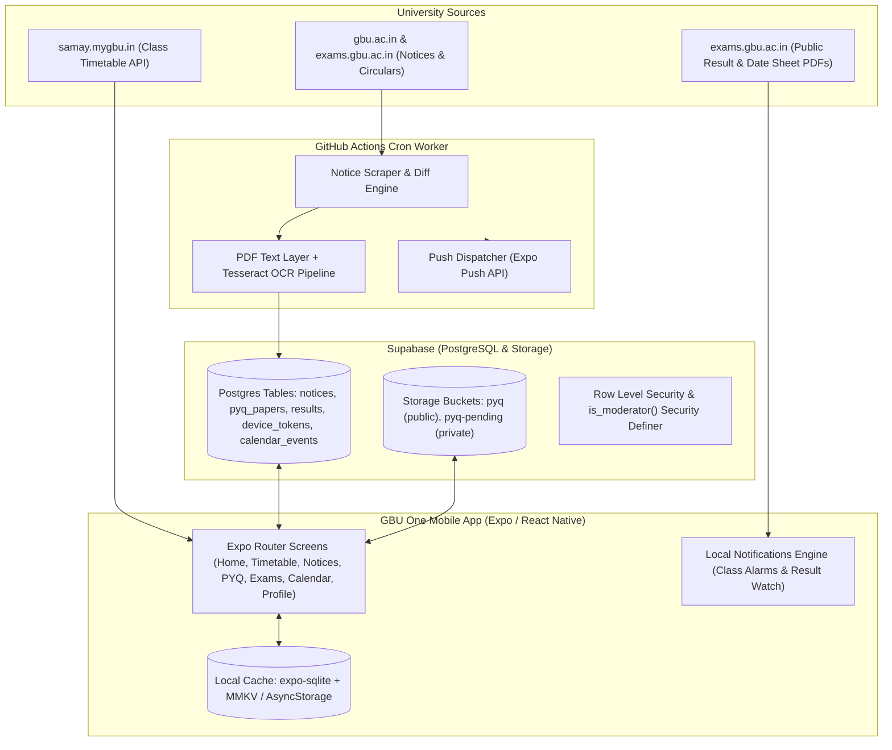

# GBU One — Official Student Companion App

> **Gautam Buddha University (GBU), Greater Noida**  
> An all-in-one, offline-first mobile app unifying real university notices, timetable, class alarms, exam results, previous year question papers (PYQs), academic calendar, and campus events.

---

## 1. Quick Orientation for Agents & Engineers

If you are an AI agent or a developer working on this codebase:

1. **Test Suite Status**: **420 passed, 420 total across 29 test suites**. Always run `npm test` before committing changes.
2. **Current Project State**: Phases 0 through 6 core implementations are **shipped and verified**. 
3. **Strict Stack**:
   - **Framework**: Expo (React Native SDK 52) with TypeScript (strict), Expo Router v4.
   - **State & Data**: Zustand (with MMKV/AsyncStorage persistence) + TanStack Query v5.
   - **Offline Storage**: `expo-sqlite` (structured notice/timetable cache) + MMKV.
   - **Backend**: Supabase (Postgres, Storage buckets, Auth).
   - **Background Worker**: Node.js + TypeScript scraper & push sender running via GitHub Actions cron.
4. **Primary Documentation Index**:
   - [`AGENTS.md`](./AGENTS.md) — Fundamental coding rules, stack constraints, and working protocols.
   - [`docs/ARCHITECTURE.md`](./docs/ARCHITECTURE.md) — System design, database schemas, offline-first data flow, and RLS architecture.
   - [`docs/DATA_SOURCES.md`](./docs/DATA_SOURCES.md) — University endpoints, scraping rules, API specifications, and fallback sources.
   - [`docs/ROADMAP.md`](./docs/ROADMAP.md) — Detailed phase-by-phase completion log and next items.
   - [`docs/OPEN_QUESTIONS.md`](./docs/OPEN_QUESTIONS.md) — Live registry of open questions, owner decisions, and external blockers.
   - [`docs/ADMIN_MODERATION.md`](./docs/ADMIN_MODERATION.md) — Supabase RLS setup, SQL migration, and moderation runbook.
   - [`docs/PYQ_IMPORT.md`](./docs/PYQ_IMPORT.md) — Archive import provenance, folder/file mappings, and resolution progress.
   - [`docs/FULL_UI_AUDIT.md`](./docs/FULL_UI_AUDIT.md) — UI repair audit and visual standard rules.

---

## 2. Architecture & Data Flow



---

## 3. What Is Done & Verified (Shipped)

### A. Authentication & User Model
- **Honest Guest Mode**: Full access to all public information (notices, timetable, exam sheets, calendar) without an account.
- **Dual Login Support**: Sign in with university roll number or direct email (`toLoginEmail()`).
- **Role-Based Access Control**: Strict role separation (`owner`, `moderator`, `student`) enforced by `public.is_moderator()` security definer function.
- **Student Privacy Rule**: The app **never** collects, logs, or stores university portal passwords.

### B. Timetable & Class Reminders
- **Live University Catalogue**: Reverse engineered from `samay.mygbu.in/api.php` (`schd=39` current, `schd=40` next semester) with bundled offline fallback.
- **Dynamic Class Picker**: School → Programme → Semester → Section (`SectionName` matching e.g., `BCS-II A`).
- **Class Alarms**: Configurable lead time reminders (0, 10, 15, 30, 45, 60, 120 minutes) scheduled via local OS notifications.
- **Offline Sync & Change Detection**: SQLite snapshot cache with 6-hour TTL, slot diff engine, and UI "Changed" indicators.

### C. Notices & Attachment Processing
- **Real Scraped Feed**: 245+ live notices mapped from `gbu.ac.in` and `exams.gbu.ac.in` with categories, published dates, and verified links.
- **In-App Document Viewer**: Native PDF viewer with fallback handoff to external readers.
- **Attachment Pipeline**: SHA-256 content deduplication, zero-dependency PDF text layer extraction, and Tesseract Devanagari/English OCR for scanned circulars.
- **Deadline Extraction & Audience Targeting**: Automated circular classification and targeted push dispatch.

### D. Previous Year Questions (PYQ)
- **Telegram Archive Migration**: Ingested student archive (45 folders, 162 files) into 39 structured `pending` database records with provenance tracking.
- **Moderation Workflow**: Dual-bucket architecture (`pyq-pending` private, `pyq` public). Approving promotes files and records audit logs; rejection removes files safely.
- **Bulk Actions**: One-click "Approve All" capability for administrators in `app/moderation.tsx`.
- **Upload Resilience**: Offline upload queue for students with pending sync state.

### E. Exams, Results & Academic Calendar
- **Exam Hub**: Date sheet viewer, revision alerts, and countdown timers.
- **Results Watch**: Device-side `Last-Modified` / HTTP HEAD poller monitoring public examination portal result sheets, firing local alerts when revised without scraping captcha-protected login gates.
- **Academic Calendar**: Official 2026-27 calendar parsed into categorized events with direct PDF references.
- **Manual Attendance Tracker**: Visual battery level indicator with local persistence.

### F. UI/UX Design System
- **Light-First Palette**: Semantic light theme with WCAG AA contrast compliance and dark-mode fallback tokens.
- **Motion Components**: Streamlined 1.7s splash with UI-thread TypeWriter, LetterRise, GlassCard, and floating dock navigation.
- **Accessibility**: 44dp minimum touch targets across all interactive elements.

---

## 4. What Is Remaining (Owner Action Items & Blockers)

The application code is complete and passing 100% of tests. The following items require external credentials or human decisions (detailed in [`docs/OPEN_QUESTIONS.md`](./docs/OPEN_QUESTIONS.md)):

| Item | Status | Action Required | Reference |
|---|---|---|---|
| **Supabase RLS Activation** | Ready for paste | Open Supabase dashboard → SQL Editor → paste and run [`supabase/schema.sql`](./supabase/schema.sql) | [`docs/ADMIN_MODERATION.md`](./docs/ADMIN_MODERATION.md) |
| **Push Credentials** | Awaiting IDs | Provide EAS Project ID (`expo.extra.eas.projectId`) and FCM `google-services.json` | [`docs/OPEN_QUESTIONS.md`](./docs/OPEN_QUESTIONS.md) #11, #12 |
| **PYQ Archive Disambiguation** | 103 files pending | Fill in `scripts/pyq-import/import-answers.csv` for 51 multi-programme and 52 unmapped subject files | [`docs/OPEN_QUESTIONS.md`](./docs/OPEN_QUESTIONS.md) #20 |
| **Student Survey Feedback** | Awaiting survey data | Share survey with class reps and record results in `docs/qa/survey-responses.csv` | [`docs/SURVEY.md`](./docs/SURVEY.md) |
| **Official Seal & Clearances** | In discussion | Obtain vector GBU seal and written terms for circular republication | [`docs/OPEN_QUESTIONS.md`](./docs/OPEN_QUESTIONS.md) #3, #9, #10 |
| **16 KB Android Page Size** | Planned | Plan upgrade to Expo SDK 53 / React Native 0.79+ for Google Play 16 KB page-size compliance | [`docs/OPEN_QUESTIONS.md`](./docs/OPEN_QUESTIONS.md) #13 |

---

## 5. Development & Verification Commands

```bash
# Run complete test suite (29 suites, 420 unit & integration tests)
npm test

# Generate synchronized SQL from TypeScript schema definition
node tools/emit-sql.mjs

# Verify RLS policies and moderator permissions (requires .env)
node scripts/_rls-probe.js

# Seed or rotate local admin account credentials
node scripts/_seed-admin.js

# Run background worker scraper locally
npm --prefix worker run scrape
```
