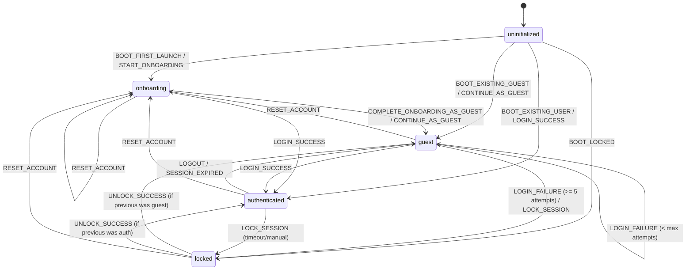
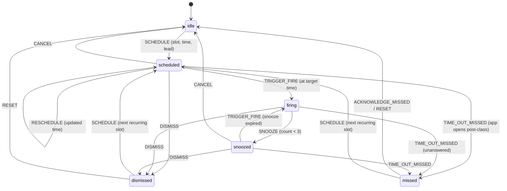
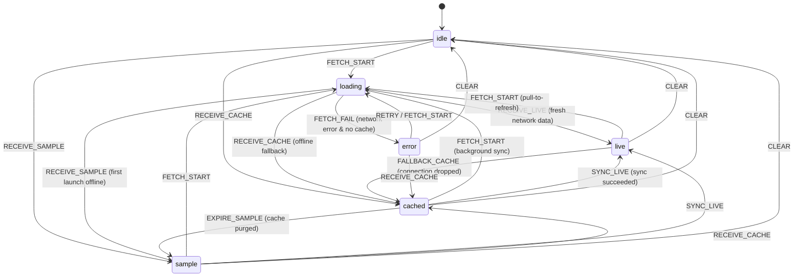
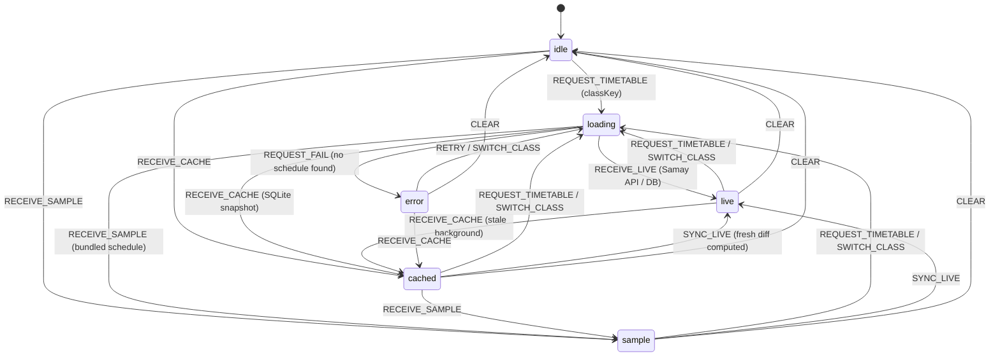
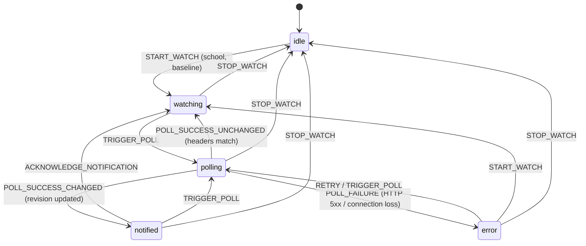

# GBU One — Typed State-Machine Layer Documentation

This document specifies the architecture, formal state diagrams, transition tables, and invariant contracts for the typed state machines implemented in `src/state/`.

The state machine layer provides pure, deterministic reducers and transition guards that enforce business logic, security policies, and offline-first data guarantees across GBU One.

---

## 1. Architecture Overview

Every state machine in `src/state/` follows a uniform architectural pattern:
- **Pure Functional Reducer**: `(state, event) => nextState` with no I/O side effects, network calls, or clock mutations.
- **Transition Result Wrapper**: `transition<Machine>(state, event)` returning `{ ok: boolean, state: State, error?: string }` for explicit rejection handling.
- **Transition Guard**: `canTransition<Machine>(state, eventType)` returning boolean for UI action enabling/disabling.
- **Invariant Validation**: `validate<Machine>Invariants(state)` validating safety assertions before persisting or consuming state.

```
+--------------------------------------------------------------+
|                     GBU One UI & Stores                      |
| (Zustand, React Components, Background Workers, SQLite/MMKV) |
+------------------------------+-------------------------------+
                               |
                        Dispatches Event
                               v
+--------------------------------------------------------------+
|               Typed State-Machine Reducer                    |
|                `(state, event) => nextState`                 |
|                                                              |
|   - Evaluates transition legality against current state      |
|   - Rejects illegal transitions with diagnostic errors       |
|   - Updates context fields immutably                         |
|   - Enforces domain invariant contracts                      |
+--------------------------------------------------------------+
```

---

## 2. S2 Auth State Machine (`src/state/authMachine.ts`)

### 2.1 State Diagram


### 2.2 States
- `uninitialized`: Initial pre-boot state prior to reading persistent storage or device credentials.
- `onboarding`: First-launch walkthrough for new students explaining notices, timetable, and PYQs.
- `guest`: Anonymous local mode. Full schedule and notice viewing enabled; cloud sync/upload displays friendly sign-up prompt.
- `authenticated`: Verified student account with university roll number, personal notifications, and PYQ upload privileges.
- `locked`: Security gate active due to brute-force protection (5 invalid attempts) or session inactivity timeout.

### 2.3 Transition Table
| Current State | Event | Target State | Context Updates |
|---|---|---|---|
| `uninitialized` | `BOOT_FIRST_LAUNCH` | `onboarding` | Resets error messages |
| `uninitialized` | `BOOT_EXISTING_GUEST` | `guest` | Sets `isGuest: true`, assigns guest ID |
| `uninitialized` | `BOOT_EXISTING_USER` | `authenticated` | Sets `userId`, `rollNo`, `isGuest: false` |
| `uninitialized` | `BOOT_LOCKED` | `locked` | Sets `lockoutUntil`, `lockReason` |
| `onboarding` | `COMPLETE_ONBOARDING_AS_GUEST` | `guest` | Sets `isGuest: true`, completes tour |
| `onboarding` | `LOGIN_SUCCESS` | `authenticated` | Sets student credentials, `isGuest: false` |
| `guest` | `LOGIN_SUCCESS` | `authenticated` | Resets `failedAttempts`, sets user credentials |
| `guest` | `LOGIN_FAILURE` (< 5) | `guest` | Increments `failedAttempts` |
| `guest` | `LOGIN_FAILURE` (>= 5) | `locked` | Sets `lockoutUntil = now + 300s`, sets `previousState: 'guest'` |
| `guest` | `LOCK_SESSION` | `locked` | Sets lock reason and optional timer |
| `authenticated` | `LOGOUT` | `guest` | Clears roll number, sets `isGuest: true` |
| `authenticated` | `SESSION_EXPIRED` | `guest` | Preserves local schedule, sets friendly notice |
| `authenticated` | `LOCK_SESSION` | `locked` | Sets `previousState: 'authenticated'` |
| `locked` | `UNLOCK_SUCCESS` | `authenticated` \| `guest` | Clears `lockoutUntil`, resets `failedAttempts` to 0 |

### 2.4 Invariant Rules
1. **Never store university passwords**: Passwords processed by auth machines are app-specific accounts only.
2. **Guest exclusivity**: In `'guest'`, `context.isGuest === true`. In `'authenticated'`, `context.isGuest === false` and `context.userId` must be non-empty.
3. **Lockout integrity**: When locked via brute force, `lockoutUntil` must be in the future and `failedAttempts >= 5`.

---

## 3. S8 Class Alarm State Machine (`src/state/alarmMachine.ts`)

### 3.1 State Diagram


### 3.2 States
- `idle`: No alarm armed for the slot.
- `scheduled`: OS notification armed with lead time (default: 10 minutes before class).
- `firing`: Alarm is actively ringing/vibrating and demanding student response.
- `snoozed`: Silenced temporarily for snooze duration (default: 5 minutes, max 3 times).
- `dismissed`: Student explicitly acknowledged class attendance.
- `missed`: Alarm was unanswered within the active window.

### 3.3 Transition Table
| Current State | Event | Target State | Guards & Rules |
|---|---|---|---|
| `idle` | `SCHEDULE` | `scheduled` | Requires valid `slotId` and positive `scheduledTime` |
| `scheduled` | `TRIGGER_FIRE` | `firing` | Records `firingStartedAt` |
| `scheduled` | `CANCEL` | `idle` | Cleans up notification references |
| `scheduled` | `TIME_OUT_MISSED` | `missed` | Fires if class period already elapsed |
| `firing` | `SNOOZE` | `snoozed` | Guard: `snoozeCount < maxSnoozes` (3); sets `snoozedUntil` |
| `firing` | `SNOOZE` | `firing` (rejected) | If `snoozeCount >= maxSnoozes`, remains in `firing` |
| `firing` | `DISMISS` | `dismissed` | Records `dismissedAt` |
| `firing` | `TIME_OUT_MISSED` | `missed` | Records `missedAt` |
| `snoozed` | `TRIGGER_FIRE` | `firing` | Clears `snoozedUntil`, sets `firingStartedAt` |
| `snoozed` | `DISMISS` | `dismissed` | Records `dismissedAt` |
| `dismissed` | `SCHEDULE` | `scheduled` | Re-arms alarm for next week's recurrence |
| `missed` | `ACKNOWLEDGE_MISSED` | `idle` | Clears missed alarm badge |

### 3.4 Invariant Rules
1. **Snooze ceiling**: Snooze cannot exceed `maxSnoozes` (3).
2. **Timestamp consistency**: In `'firing'`, `firingStartedAt` must be set. In `'snoozed'`, `snoozedUntil` must be set.

---

## 4. S11 Notices Source State Machine (`src/state/noticesMachine.ts`)

### 4.1 State Diagram


### 4.2 States
- `idle`: Uninitialized notice state before queries execute.
- `loading`: Network query or cache retrieval currently in flight.
- `live`: Notices populated directly from live university portals (`gbu.ac.in`, `exams.gbu.ac.in`).
- `cached`: Notices loaded from local SQLite cache during offline use or transient network drop.
- `sample`: Bundled offline demo notices; honestly badged as sample data per user instructions.
- `error`: Failed fetch where neither network, cache, nor sample is accessible.

### 4.3 Invariant Rules
1. **Zero fabricated notices**: The machine never presents sample data as live notices.
2. **Cache validity**: In `'cached'`, `cacheTimestamp` must be a valid epoch millisecond.
3. **Error specificity**: In `'error'`, `errorMessage` must detail the HTTP/network fault.

---

## 5. S12 Timetable Source State Machine (`src/state/timetableMachine.ts`)

### 5.1 State Diagram


### 5.2 States
- `idle`: No programme or section selected yet.
- `loading`: Fetching timetable matrix for selected `classKey` (e.g., `BTECH_CSE_SEM4`).
- `live`: Active schedule verified from university server, with diffs checked for room/time changes.
- `cached`: Offline schedule loaded from local SQLite cache.
- `sample`: Bundled fallback schedule for demo or initial onboarding.
- `error`: Network failure with no cached schedule available for the given class.

### 5.3 Invariant Rules
1. **Class key scoping**: In `'live'`, `'cached'`, and `'loading'`, `context.classKey` must identify the programme section.
2. **Room shift diffing**: Detected room or schedule modifications increment `detectedChangesCount` for student badge alerts.

---

## 6. Results Watcher State Machine (`src/state/resultsMachine.ts`)

### 6.1 State Diagram


### 6.2 States
- `idle`: Results watch disabled by student.
- `watching`: Watcher active for student's school (e.g., `SOICT`), waiting for next poll cycle.
- `polling`: HEAD request in flight checking `Last-Modified` and `Content-Length` headers.
- `notified`: New result sheet detected or revised; student notified via push/in-app alert.
- `error`: Network failure during poll; exponential backoff active.

### 6.3 Invariant Rules
1. **School isolation**: A watch instance is scoped strictly to a school. Switching schools clears previous revisions to prevent false "Results Published" alerts.
2. **Baseline protection**: Initial poll captures the baseline and does NOT fire an alert; subsequent header revisions trigger transition to `'notified'`.

---

## 7. Verification & Test Coverage

All 5 state machines are verified in `tests/state_machines.test.ts`:
- **40 tests across all 5 machines**: 100% green.
- Validates every state value, every legal transition, every transition guard, context updates, and illegal transition rejection.
- Asserts domain invariant contracts across all valid and intentionally corrupted states.
